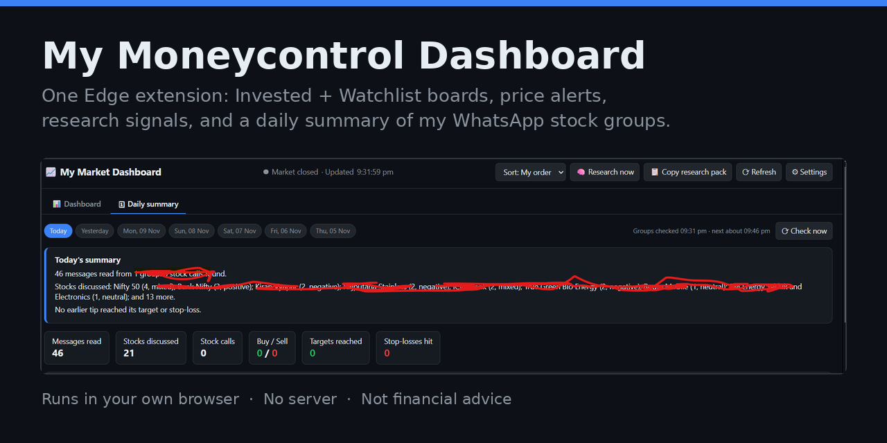

# My Moneycontrol Dashboard

A personal Microsoft Edge extension that puts all your Moneycontrol stocks on one dashboard, sends price alerts, and picks up stock tips and stock discussions from your own WhatsApp groups.

It runs entirely in your browser. There is no server, and your stocks, holdings, keys and messages stay in Edge's local storage on your computer.

## Features

- **Two boards:** "Invested" and "Watchlist". Drag stock cards between them and reorder them.
- **Live prices** for each stock and for Nifty 50, Sensex and Bank Nifty, read through your logged-in Moneycontrol session.
- **Holdings and P&L** per stock and for the whole portfolio.
- **Price alerts** to desktop notifications, Telegram, WhatsApp (CallMeBot) or email (EmailJS).
- **Research signals** from fixed rules (MC Score, analyst target, news, price trend), with an optional Claude API engine.
- **WhatsApp tips:** reads the groups you name in WhatsApp Web, keeps messages that look like a buy/sell call, tracks each tip's target and stop-loss, and alerts when one is reached.
- **Daily summary tab:** messages read, new calls, sell signals, one summary per stock discussed, activity by group, and a track record of each person's calls. Watched groups are checked every 15 minutes.

## Install

1. Download or clone this repository.
2. In Edge, open `edge://extensions` and turn on **Developer mode**.
3. Click **Load unpacked** and choose this folder.
4. Pin the extension and click its icon to open the dashboard.

See [USER-GUIDE.txt](USER-GUIDE.txt) for setup of alerts, research and WhatsApp tips.

## Limits and disclaimers

- **Not financial advice.** Tips are copied from chat groups and are unverified. Research signals and summaries are automated and can be wrong. Nothing is ever bought or sold.
- **Unofficial.** This project is not affiliated with Moneycontrol or WhatsApp. It reads pages in your own signed-in browser, and either site can change and break it. Automated reading may not be permitted by their terms; use it at your own risk and for personal use only.
- **WhatsApp reading is read-only.** The extension never sends, deletes or changes anything in WhatsApp. It reads text only, and only while WhatsApp Web is open in Edge.
- **Other people's messages are private.** Do not publish or share what the reader collects from your groups.
- **Rules, not AI.** Tip detection, stock recognition and summaries use fixed rules and will miss some messages and misread others.

## Files

| File | What it does |
|---|---|
| `manifest.json` | Extension definition and permissions |
| `background.js` | Price refresh, alerts, scheduling |
| `rules.js`, `research.js` | Research signals |
| `tips.js` | Turns a chat message into a structured tip |
| `tipsbg.js` | Stores tips, matches stocks, tracks targets and stop-losses |
| `discuss.js` | Recognises stocks named in any message |
| `tips-summary.js` | Daily summary and per-stock discussion summaries |
| `wa-content.js` | Read-only reader that runs in the WhatsApp Web tab |
| `dashboard.html`, `dashboard.css`, `dashboard.js` | Dashboard page |
| `tips-ui.js`, `summary-ui.js` | WhatsApp tips table and Daily summary tab |
